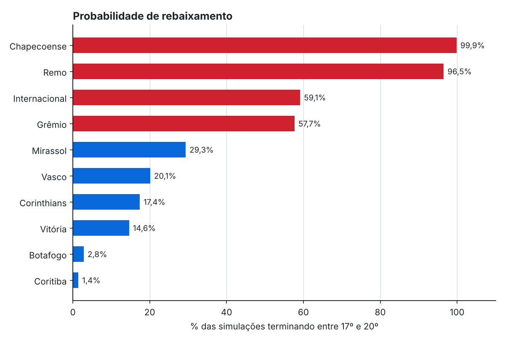

# Brasileirão 2026 — quem cai?

Modelo estatístico que estima a probabilidade de título, vaga e rebaixamento de cada clube da Série A, combinando um **modelo de gols Dixon-Coles** com **50 mil simulações Monte Carlo** do restante do campeonato.



> Resultados com dados públicos até a 28ª rodada. Rode `python -m brasileirao.pipeline --atualizar` para usar os placares mais recentes da fonte.

## Por que este projeto

Trabalho com planejamento financeiro, onde o dia a dia é transformar incerteza em probabilidades e cenários. Este projeto aplica o mesmo raciocínio a um problema público, com dados abertos, para mostrar o ciclo completo de um trabalho de dados: coleta, limpeza, SQL, modelagem, **validação honesta** e comunicação dos resultados.

## O que tem aqui

| Etapa | Onde | O que faz |
|---|---|---|
| Coleta e limpeza | `src/brasileirao/dados.py` | Baixa o JSON público, padroniza nomes e placares, valida (20 clubes, 380 jogos, sem duplicatas) |
| SQL | `sql/` + `banco.py` | Banco SQLite com tabela de fatos e visão por clube; classificação com desempate, casa x fora, forma recente com funções de janela, dificuldade do calendário |
| Modelo | `modelo.py` | Dixon-Coles (Poisson com correção de placares baixos), ajustado por máxima verossimilhança ponderada com `scipy` |
| Validação | `avaliacao.py` | Backtest rolante: treina até a rodada *r*, prevê a *r+1*; compara com referências ingênuas por log loss e Brier |
| Simulação | `simulacao.py` | Monte Carlo vetorizado em NumPy (50 mil temporadas em ~1 s), com critérios oficiais de desempate |
| Análise | `notebooks/analise.ipynb` | A história completa, passo a passo, com tabelas e gráficos |
| Testes | `tests/` | Integridade dos dados, coerência da tabela e da simulação (`pytest`) |

## Como o modelo funciona

Os gols de cada lado seguem uma Poisson:

```
log(gols esperados do mandante)  = μ + mando + ataque[mandante]  + defesa[visitante]
log(gols esperados do visitante) = μ         + ataque[visitante] + defesa[mandante]
```

A correção de Dixon & Coles (1997) ajusta a chance de 0x0, 1x0, 0x1 e 1x1. Uma penalidade ridge evita forças extremas com poucos jogos.

**Jogos atípicos pesam menos.** O saldo de cada jogo é medido em desvios-padrão da média da liga: até 1 DP o jogo vale 1, entre 1 e 2 DP vale 0,7, acima de 2 DP vale 0,4. Uma goleada fora da curva não redefine a força de um time.

## Decisões tomadas com dados, não no olho

Testei três hipóteses de modelagem no mesmo backtest rolante (157 jogos previstos sem que o modelo os tivesse visto):

| Hipótese | Resultado | Decisão |
|---|---|---|
| Peso menor para jogos atípicos | melhora em todas as combinações | **mantido** |
| Peso maior para jogos recentes (meia-vida 30–120 dias) | piora: com ~280 jogos e só gols, descarta informação demais | **descartado** |
| Vantagem de casa própria de cada clube | não melhora: a diferença casa/fora vista na tabela é, em boa parte, ruído de amostra | **descartado** |

Desempenho do modelo final (menor = melhor):

| | Log loss | Brier |
|---|---|---|
| **Modelo Dixon-Coles** | **1,064** | **0,648** |
| Frequência histórica (mandante/empate/visitante) | 1,078 | 0,652 |
| Uniforme (1/3 para cada) | 1,099 | 0,667 |

O ganho é real, mas modesto. Isso é esperado no futebol, um esporte de poucos gols, e é exatamente o que motiva a próxima versão com xG.

## Como rodar

```bash
git clone https://github.com/mlsantos92/brasileirao-monte-carlo
cd brasileirao-monte-carlo
python -m venv .venv && source .venv/bin/activate   # Windows: .venv\Scripts\activate
pip install -r requirements.txt
pip install -e .

python -m brasileirao.pipeline --atualizar   # baixa dados, roda tudo e grava outputs/
pytest                                       # testes
jupyter notebook notebooks/analise.ipynb     # análise completa
```

Saídas em `outputs/`: probabilidades por clube, previsões jogo a jogo, forças estimadas, curva de corte do rebaixamento, resultados do backtest e de cada consulta SQL.

## Limitações

- Usa só placares: não sabe de lesões, suspensões, troca de técnico, viagens ou copas.
- Cada jogo simulado é independente; não há efeito de "momento" dentro da simulação.
- A fonte pública pode estar algumas rodadas atrás do campeonato real.

## Próximos passos

- Trocar gols por **xG e grandes chances por mando**, métricas menos ruidosas.
- Curva de calibração (as partidas com 60% de chance acontecem em ~60% das vezes?).
- Testar descanso entre jogos e desfalques com o mesmo backtest.

## Sobre o uso de IA

O projeto foi desenvolvido com IA como copiloto de código. As perguntas, as hipóteses de modelagem (pesos para jogos atípicos, recência, mando por clube), os critérios de validação e a interpretação dos resultados são meus; a IA acelerou a escrita da sintaxe. Todo o código é testado e reproduzível.

## Dados

Placares: [openfootball/football.json](https://github.com/openfootball/football.json), domínio público.
